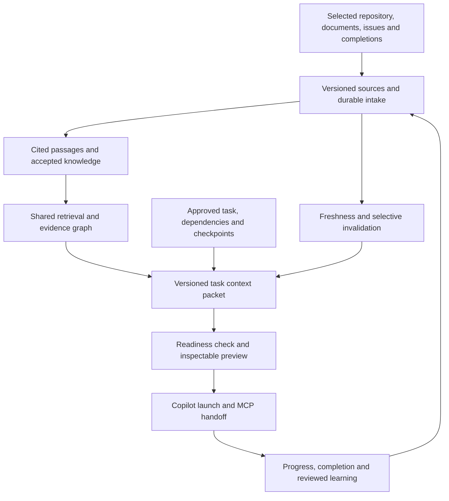

# Workstack architecture, product and project-context review

Reviewed 2026-09-09 at Workstack commit `5543694b951d7e7f5206b3c807abea32993d5ef0`.

[GitHub review roadmap](https://github.com/andrewhobden/workstack/issues/49) · 43 improvement issues

## Assessment

Workstack has substantial foundations: SQLite-backed atomic claims, opaque tokens and leases, structured completions, isolated Git worktrees, MCP access, AI planning with protected human fields, raw knowledge, generated wiki articles and dependency artifacts. Its broad renderer suite also includes visual and accessibility coverage.

The highest-value improvement is reliability across boundaries. Desktop edits currently pass routing fields to strict domain patches; planning conversion omits richer fields and evidence; workspace identity depends on task titles; interrupted work lacks a durable checkpoint; and PR/knowledge transitions can lose recovery state. These defects reduce the value of additional autonomous capability until fixed.

Knowledge currently uses several independent lexical retrieval paths. The launcher includes at most five wiki article prefixes and a small recent graph window, while planning and chat assemble different evidence. Existing wiki automation is a useful start, but generation success, source freshness, accepted guidance and task readiness need distinct states.

The review created 43 improvement issues: 22 bugs and 21 enhancements; 26 P1 and 17 P2. Thirty address Workstack directly and thirteen extend its project-context capabilities. GitHub is the authoritative backlog; the linked tracking issue adds sequencing and a checklist.

## Recommended context architecture

The main extension is a **versioned context packet for every task**. It combines the full approved task, project purpose and current focus, applicable architecture/contracts, development and test instructions, authoritative decisions, source evidence, affected code/tests, prerequisites and previous-agent checkpoints. A manifest records exact source revisions, freshness, selection reasons and omissions. The desktop preview and MCP/launcher consume the same packet.

“Full context” needs explicit required categories, observable gaps and drill-down evidence. A large prompt or successful search cannot certify completeness. Required specifications must never be silently truncated; readiness policy identifies missing mandatory evidence before execution, and permitted soft-gap overrides are recorded for the worker.

## Delivery sequence

1. **Make existing execution dependable.** Fix desktop patch handling ([#14](https://github.com/andrewhobden/workstack/issues/14)), preserve worktrees and workspace identity ([#6](https://github.com/andrewhobden/workstack/issues/6), [#7](https://github.com/andrewhobden/workstack/issues/7)), handle PR/claim states ([#8](https://github.com/andrewhobden/workstack/issues/8), [#9](https://github.com/andrewhobden/workstack/issues/9), [#10](https://github.com/andrewhobden/workstack/issues/10), [#11](https://github.com/andrewhobden/workstack/issues/11)), and protect provider/data boundaries ([#19](https://github.com/andrewhobden/workstack/issues/19), [#20](https://github.com/andrewhobden/workstack/issues/20), [#21](https://github.com/andrewhobden/workstack/issues/21), [#22](https://github.com/andrewhobden/workstack/issues/22), [#26](https://github.com/andrewhobden/workstack/issues/26)). Restore CI and real boundary checks in parallel ([#17](https://github.com/andrewhobden/workstack/issues/17), [#30](https://github.com/andrewhobden/workstack/issues/30), [#31](https://github.com/andrewhobden/workstack/issues/31), [#35](https://github.com/andrewhobden/workstack/issues/35)).
2. **Preserve the complete handoff and its evidence.** Keep full planning content and checkpoints ([#13](https://github.com/andrewhobden/workstack/issues/13), [#24](https://github.com/andrewhobden/workstack/issues/24), [#25](https://github.com/andrewhobden/workstack/issues/25), [#27](https://github.com/andrewhobden/workstack/issues/27)); make knowledge updates recoverable and incremental ([#28](https://github.com/andrewhobden/workstack/issues/28), [#29](https://github.com/andrewhobden/workstack/issues/29)); add the source catalog, repository intake and cited passages ([#36](https://github.com/andrewhobden/workstack/issues/36), [#37](https://github.com/andrewhobden/workstack/issues/37), [#39](https://github.com/andrewhobden/workstack/issues/39)).
3. **Ship a minimum context packet.** Define the packet contract ([#46](https://github.com/andrewhobden/workstack/issues/46)) early and build its first version from existing lexical retrieval plus the new source/section interfaces. Add accepted knowledge and lifecycle ([#41](https://github.com/andrewhobden/workstack/issues/41), [#42](https://github.com/andrewhobden/workstack/issues/42)), freshness ([#38](https://github.com/andrewhobden/workstack/issues/38)) and readiness ([#47](https://github.com/andrewhobden/workstack/issues/47)). Begin the evaluation corpus ([#48](https://github.com/andrewhobden/workstack/issues/48)) alongside the packet contract.
4. **Improve discovery and coordination.** Add optional semantic search ([#40](https://github.com/andrewhobden/workstack/issues/40)), canonical components ([#43](https://github.com/andrewhobden/workstack/issues/43)), evidence/impact graph ([#44](https://github.com/andrewhobden/workstack/issues/44)) and explicit task dependencies ([#45](https://github.com/andrewhobden/workstack/issues/45)). Semantic search is an enrichment; mandatory evidence and inspectable provenance must work with lexical retrieval.
5. **Complete supporting recovery and usability.** Finish completion-search retention, attachment retry, wiki reading, relocation, request resilience, onboarding and stable visible IDs ([#12](https://github.com/andrewhobden/workstack/issues/12), [#16](https://github.com/andrewhobden/workstack/issues/16), [#18](https://github.com/andrewhobden/workstack/issues/18), [#23](https://github.com/andrewhobden/workstack/issues/23), [#32](https://github.com/andrewhobden/workstack/issues/32), [#33](https://github.com/andrewhobden/workstack/issues/33), [#34](https://github.com/andrewhobden/workstack/issues/34)), with project-scoped live UI state ([#15](https://github.com/andrewhobden/workstack/issues/15)) delivered alongside the early desktop fixes.

## Lessons for independent implementation

| Lesson | Independent Workstack feature |
| --- | --- |
| Preserve source identity separately from derived knowledge | Versioned source catalog and observable intake (#36) |
| Acquire selected project evidence through a common pipeline | Repository/docs and optional GitHub source bootstrap (#37) |
| Distinguish successful indexing from current evidence | Source freshness and selective invalidation (#38) |
| Retrieve precise sections with provenance | Revisioned cited passages and bounded source reads (#39) |
| Combine exact and semantic matching | One retrieval service with optional local embeddings (#40) |
| Curate durable knowledge explicitly | Reviewable changes, restorable history and typed lifecycle (#41–#42) |
| Normalize project language and preserve evidence links | Components/aliases and typed impact navigation (#43–#44) |
| Make context delivery an execution contract | Task dependencies, context packets, readiness and evaluation (#45–#48) |

These are Workstack-owned implementations. No Knowledge Team integration, service, package dependency, database connection or data synchronization is proposed. The private source comparison is retained in a separate local report outside this public checkout. Task readiness and context-packet guarantees are new Workstack designs, not claims about the reference project's existing completeness.

## Verification and limits

Validation on macOS arm64 / Node 24.6.0 / npm 11.5.2:

- Clean dependency install, lint, TypeScript checking and production main/preload/renderer build passed.
- All 103 non-browser assertions in 21 files passed, including the contract/integration files selected by Vitest. The coverage command failed its declared 100% thresholds: lines/statements 93.71%, branches 93.79%, functions 93.81%.
- All 22 browser tests passed, including visual and accessibility checks, using an isolated preview endpoint. An initial run against the default port was discarded because the runner reused an unrelated local server; #35 records that environment defect.
- Dependency audit reported 27 affected packages: 3 critical, 18 high, 6 moderate. These counts require exposure triage; they do not establish application exploitability.
- Native Electron launch, signed packaging/notarization, real Copilot execution and live provider behavior were not exercised. Repository CI targets Node 22; the local run does not substitute for that CI environment.

Code findings are static call-path findings unless identified as observed above. Knowledge Team was reviewed through its implementation and existing tests; its services and test suite were not run. No implementation source was changed.

## Issue index

| Issue | Priority | Improvement |
| --- | --- | --- |
| [#6](https://github.com/andrewhobden/workstack/issues/6) | P1 | Preserve uncommitted work when relaunching or restacking Copilot |
| [#7](https://github.com/andrewhobden/workstack/issues/7) | P1 | Persist unique worktree and branch identities independently of task titles |
| [#8](https://github.com/andrewhobden/workstack/issues/8) | P1 | Recover tasks whose submitted pull request is closed and expose delivery state accurately |
| [#9](https://github.com/andrewhobden/workstack/issues/9) | P1 | Resolve MCP work-item display IDs across the entire project |
| [#10](https://github.com/andrewhobden/workstack/issues/10) | P1 | Honor expiry settings and recommend heartbeat intervals within each granted lease |
| [#11](https://github.com/andrewhobden/workstack/issues/11) | P2 | Reconcile tracked pull requests independently of the latest-100 PR list |
| [#12](https://github.com/andrewhobden/workstack/issues/12) | P2 | Preserve completion search content when editing work-item metadata |
| [#13](https://github.com/andrewhobden/workstack/issues/13) | P1 | Capture durable agent checkpoints before completion and include them in task handoffs |
| [#14](https://github.com/andrewhobden/workstack/issues/14) | P1 | Fix desktop work-item and planning updates passing routing IDs into strict patches |
| [#15](https://github.com/andrewhobden/workstack/issues/15) | P1 | Keep desktop state scoped to the selected project and refresh open work-item details |
| [#16](https://github.com/andrewhobden/workstack/issues/16) | P2 | Make work-item submission recoverable after attachment failures and repeated clicks |
| [#17](https://github.com/andrewhobden/workstack/issues/17) | P1 | Add real Electron and IPC smoke coverage and make browser demo fallback explicit |
| [#18](https://github.com/andrewhobden/workstack/issues/18) | P2 | Let users open and read generated wiki articles with full Markdown and provenance |
| [#19](https://github.com/andrewhobden/workstack/issues/19) | P1 | Bind stored AI credentials to their configured provider |
| [#20](https://github.com/andrewhobden/workstack/issues/20) | P1 | Keep healthy projects accessible when another project is unavailable |
| [#21](https://github.com/andrewhobden/workstack/issues/21) | P1 | Make project metadata and registry mutations recoverable under failures and concurrency |
| [#22](https://github.com/andrewhobden/workstack/issues/22) | P1 | Create a consistent project snapshot and drain writers before deletion |
| [#23](https://github.com/andrewhobden/workstack/issues/23) | P2 | Reconnect moved project folders without retaining the old absolute path |
| [#24](https://github.com/andrewhobden/workstack/issues/24) | P1 | Preserve the complete plan and its artifacts when creating a task |
| [#25](https://github.com/andrewhobden/workstack/issues/25) | P1 | Make planning use the current draft, conversation and actual attachment evidence |
| [#26](https://github.com/andrewhobden/workstack/issues/26) | P1 | Add explicit capability profiles for knowledge chat and launched agents |
| [#27](https://github.com/andrewhobden/workstack/issues/27) | P2 | Persist and replay native tool-call transcripts across supported AI providers |
| [#28](https://github.com/andrewhobden/workstack/issues/28) | P1 | Update generated wiki pages incrementally and publish a consistent revision |
| [#29](https://github.com/andrewhobden/workstack/issues/29) | P1 | Make completion-to-knowledge delivery durable and idempotent |
| [#30](https://github.com/andrewhobden/workstack/issues/30) | P1 | Restore a passing CI quality gate with meaningful coverage of current behavior |
| [#31](https://github.com/andrewhobden/workstack/issues/31) | P1 | Triage dependency advisories and upgrade the desktop and build toolchain |
| [#32](https://github.com/andrewhobden/workstack/issues/32) | P2 | Add cancellation, timeouts and bounded retry to AI requests |
| [#33](https://github.com/andrewhobden/workstack/issues/33) | P2 | Document installation, agent setup and project recovery for contributors and users |
| [#34](https://github.com/andrewhobden/workstack/issues/34) | P2 | Never reuse a project work-item display ID after deletion |
| [#35](https://github.com/andrewhobden/workstack/issues/35) | P2 | Prevent local Playwright runs from silently testing an unrelated server on port 4173 |
| [#36](https://github.com/andrewhobden/workstack/issues/36) | P1 | Store versioned project sources and expose durable intake progress |
| [#37](https://github.com/andrewhobden/workstack/issues/37) | P1 | Bootstrap project context from selected repository and GitHub sources |
| [#38](https://github.com/andrewhobden/workstack/issues/38) | P1 | Track source freshness and invalidate affected project context |
| [#39](https://github.com/andrewhobden/workstack/issues/39) | P1 | Index project knowledge as revisioned passages with precise source citations |
| [#40](https://github.com/andrewhobden/workstack/issues/40) | P2 | Use one knowledge retrieval service with lexical ranking and optional local semantic search |
| [#41](https://github.com/andrewhobden/workstack/issues/41) | P2 | Review evidence-backed knowledge changes and retain restorable article history |
| [#42](https://github.com/andrewhobden/workstack/issues/42) | P2 | Track decisions, requirements and risks with lifecycle, supersession and actionable knowledge checks |
| [#43](https://github.com/andrewhobden/workstack/issues/43) | P2 | Create a project component and glossary directory with aliases and source mentions |
| [#44](https://github.com/andrewhobden/workstack/issues/44) | P2 | Add a typed project evidence graph for dependency and impact navigation |
| [#45](https://github.com/andrewhobden/workstack/issues/45) | P2 | Model task dependencies and show overlapping active work before launch |
| [#46](https://github.com/andrewhobden/workstack/issues/46) | P1 | Build a versioned project-context packet for every Copilot task |
| [#47](https://github.com/andrewhobden/workstack/issues/47) | P1 | Check context readiness and explain missing evidence before starting an agent |
| [#48](https://github.com/andrewhobden/workstack/issues/48) | P2 | Measure task-context coverage and retrieval quality with a versioned evaluation set |
